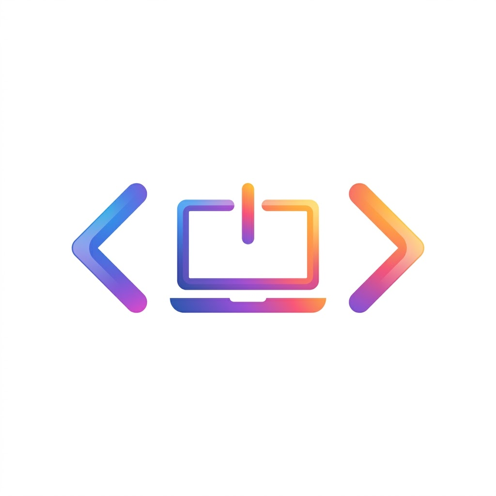

<div align="center">
  
  <h1>DigiRoom · DigiMoodle</h1>
  <p><b>Cliente nativo para iOS del Campus Virtual de Digitech FP con la experiencia limpia e intuitiva de Google Classroom.</b></p>

  <p>
    <a href="https://campus.digitechfp.com"></a>
    
    
    
    
    
  </p>
</div>

---

## 💡 ¿Qué es DigiRoom?

**DigiRoom** (también conocido como *DigiMoodle*) nace para resolver una necesidad común de los alumnos de **Digitech FP**: disfrutar de la velocidad, claridad y elegancia de la interfaz de **Google Classroom**, pero con conexión directa a los cursos, tareas y chats del campus virtual basado en **Moodle** ([campus.digitechfp.com](https://campus.digitechfp.com)).

Desarrollada de forma nativa en **SwiftUI** para iPhone e iPad, la app permite consultar entregas, revisar avisos, charlar con profesores y configurar alertas de tareas a tu medida.

---

## ✨ Características Principales

### 🎨 Experiencia Google Classroom
* **Diseño fiel y minimalista**: Tarjetas de cursos con las paletas de color características de Classroom, tipografía limpia y feed sin botones innecesarios.
* **3 Pestañas por asignatura**:
  * 📢 **Novedades**: Tablón con avisos del profesor y comentarios de clase.
  * 📋 **Trabajo de clase**: Tareas organizadas por unidades temáticas y estados (*Asignada*, *Entregada*, *Calificada*).
  * 👥 **Personas**: Directorio con profesores y compañeros de aula.
* **Detalle de tarea completo**: Enunciados, archivos adjuntos (PDFs, guías) y cajón deslizable *"Tu trabajo"* para gestionar entregas y comentarios privados.
* **Menú lateral deslizable**: Acceso directo a Clases, Tareas pendientes, Chats y Ajustes.

### 💬 Chats de Moodle en Tiempo Real
* Conexión con los servicios de mensajería oficial de Moodle (`core_message_*`).
* Conversaciones privadas con profesores y grupos del curso.
* Filtros rápidos por **Todos**, **No leídos** y **Grupos**.
* Indicador de estado en línea y contador de mensajes no leídos en la barra superior.

### 🔔 Notificaciones Inteligentes y "A mi medida"
* **Recordatorio con antelación personalizable**:
  * *2 días antes* (Recomendado).
  * *1 día antes* o *3 días antes*.
  * **"A mi medida"**: Selector para elegir exactamente con cuántos días y horas de antelación quieres que te avise.
* **Hora del aviso adaptable**:
  * *Exactamente cuando quedan X días*: Si una tarea cierra el jueves a las 16:00, la alerta sonará exactamente a las 16:00 de los días previos fijados.
  * *A una hora fija*: Si prefieres recibir el aviso a una hora concreta de la mañana o la tarde (ej. 09:00).
* **Formato de notificación optimizado**:
  > **Entrega [Asignatura]**  
  > *[Día de la semana] [Hora]* — *[Nombre de la tarea]*
* **Interruptores por asignatura**: Activa o silencia avisos curso por curso.
* **Prueba instantánea**: Botón para lanzar una notificación de prueba en 3 segundos.

### 🧪 Modo Demo Integrado
* ¿Quieres probar la aplicación de inmediato sin introducir credenciales? Con un solo toque accedes a un entorno precargado con asignaturas reales de DAM (*Programación Multimedia*, *Desarrollo de Interfaces*, *Acceso a Datos*, etc.), tareas y chats simulados.

---

## 🚀 Cómo Empezar

### 📱 Abrir y Ejecutar en Xcode

1. **Clona o descarga el repositorio**:
   ```bash
   git clone https://github.com/CallMeTroli/DigiMoodle.git
   cd DigiMoodle/DigiRoom
   ```
2. **Abre el proyecto**:
   Haz doble clic sobre `DigiMoodle.xcodeproj` o ejecuta:
   ```bash
   open DigiMoodle.xcodeproj
   ```
3. **Compilar y Ejecutar**:
   * Selecciona tu simulador de iOS preferido (iPhone 15, 16...) o tu dispositivo físico.
   * Pulsa **`Cmd + R`** para iniciar.

> [!TIP]
> **Compilación desde Terminal**:
> ```bash
> xcodebuild -project DigiMoodle.xcodeproj -scheme DigiMoodle -sdk iphoneos CODE_SIGNING_ALLOWED=NO clean build
> ```

---

## 🛠️ Tecnologías y Arquitectura

Un resumen de la tecnología utilizada:

| Área | Tecnologías | Propósito |
|---|---|---|
| **Frontend iOS** | Swift 5.9+, SwiftUI, Combine | Interfaz declarativa fluida, adaptativa a Dark Mode y pantalla completa. |
| **Arquitectura** | MVVM (`ObservableObject`, `@Published`) | Separación clara entre modelos de datos, servicios de red y vistas. |
| **Alertas Locales** | `UserNotifications` (`UNUserNotificationCenter`) | Programación precisa de recordatorios locales según fechas límite. |
| **Backend Campus** | Moodle Web Services REST API v2 | Conexión con endpoints oficiales de `campus.digitechfp.com` (tokens, cursos, entregas y mensajería). |

---

## 📁 Estructura del Código

```text
DigiRoom/
├── DigiMoodle.xcodeproj     # Proyecto Xcode nativo
├── Sources/
│   ├── App/                 # Ciclo de vida de la app y vista raíz (ContentView)
│   ├── Models/              # Modelos de datos (Course, Assignment, MoodleChatMessage...)
│   ├── ViewModels/          # Lógica de estado (Auth, Classroom, Notifications)
│   ├── Services/            # Cliente Moodle REST API, NotificationManager y MockData
│   ├── Views/
│   │   ├── Home/            # Lista de cursos estilo Google Classroom
│   │   ├── Course/          # Pestañas Novedades, Trabajo de clase y Personas
│   │   ├── Assignment/      # Ficha de entrega y panel "Tu trabajo"
│   │   ├── Todo/            # Tareas pendientes y Vistas de Chat de Moodle
│   │   ├── Notifications/   # Pantalla de ajustes de notificaciones
│   │   └── Common/          # TopBar, SideDrawer y paleta de colores
│   └── Resources/           # Assets, iconos de la app y Info.plist
└── imagedigiroom.png        # Icono oficial de DigiRoom
```

---

## ⚙️ Notas sobre Firma de Código en Xcode

Si vas a instalar la app en un iPhone físico a través de Xcode:
1. Dirígete a la pestaña **Signing & Capabilities** del target `DigiMoodle`.
2. En **Team**, selecciona tu Apple ID personal o cuenta de desarrollador.
3. El Bundle Identifier se ajustará automáticamente (`com.digitech.digimoodle` o tu identificador propio).

---

## 📄 Licencia

Este proyecto está distribuido bajo la licencia [MIT](LICENSE).

---

<div align="center">
  <sub>Desarrollado por <b>Troli</b> con la ayuda de <b>Gemini</b>.</sub>
</div>
